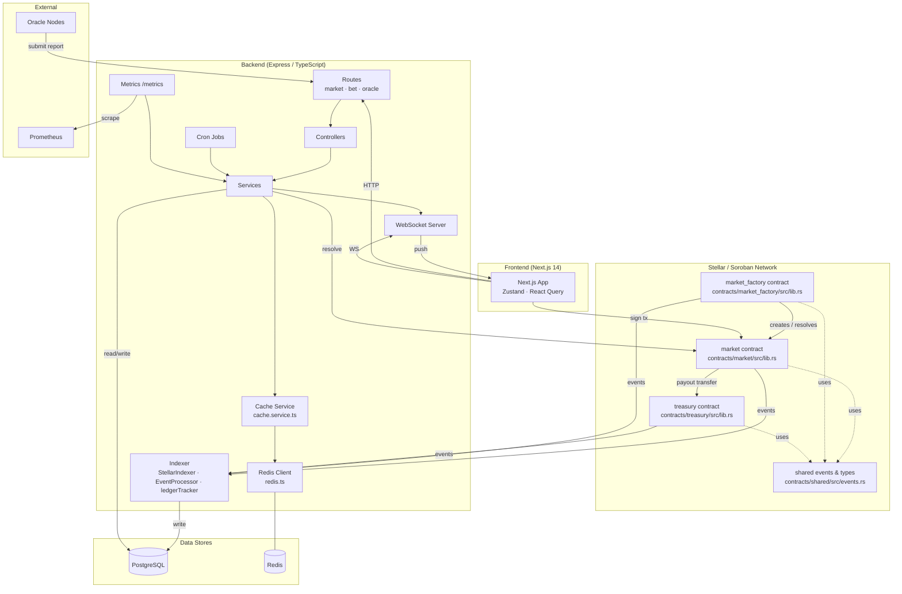
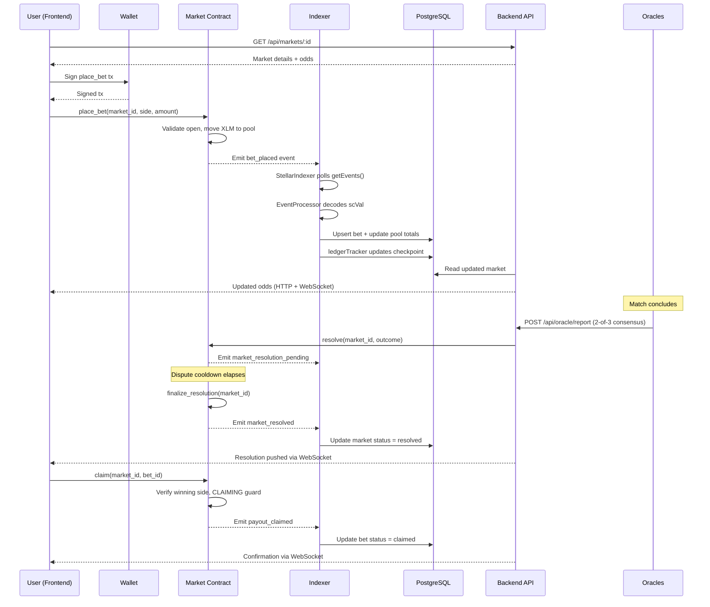
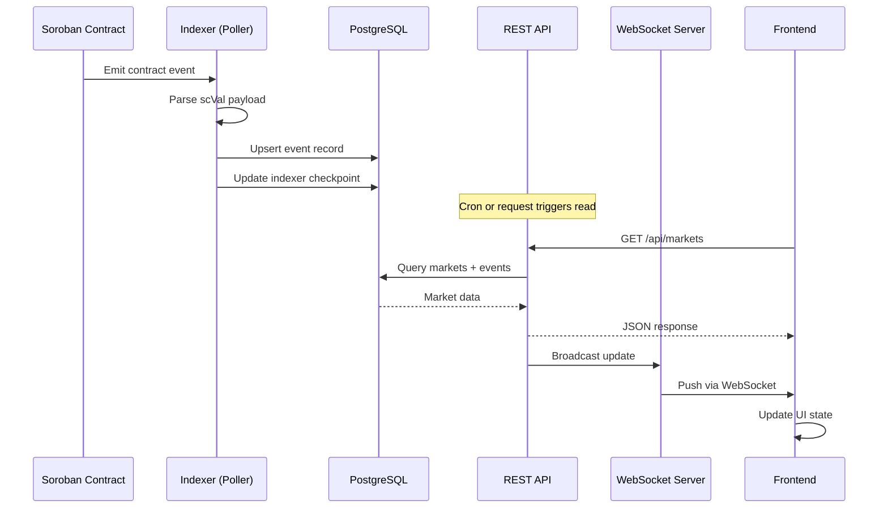
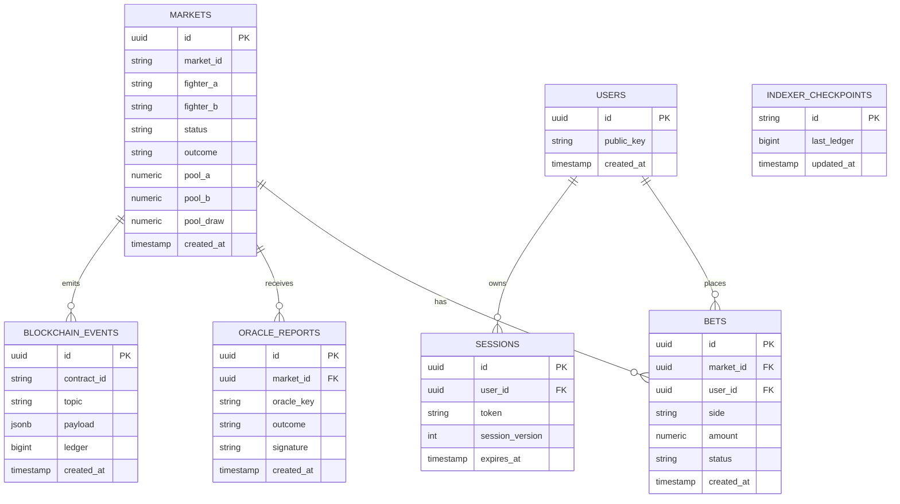
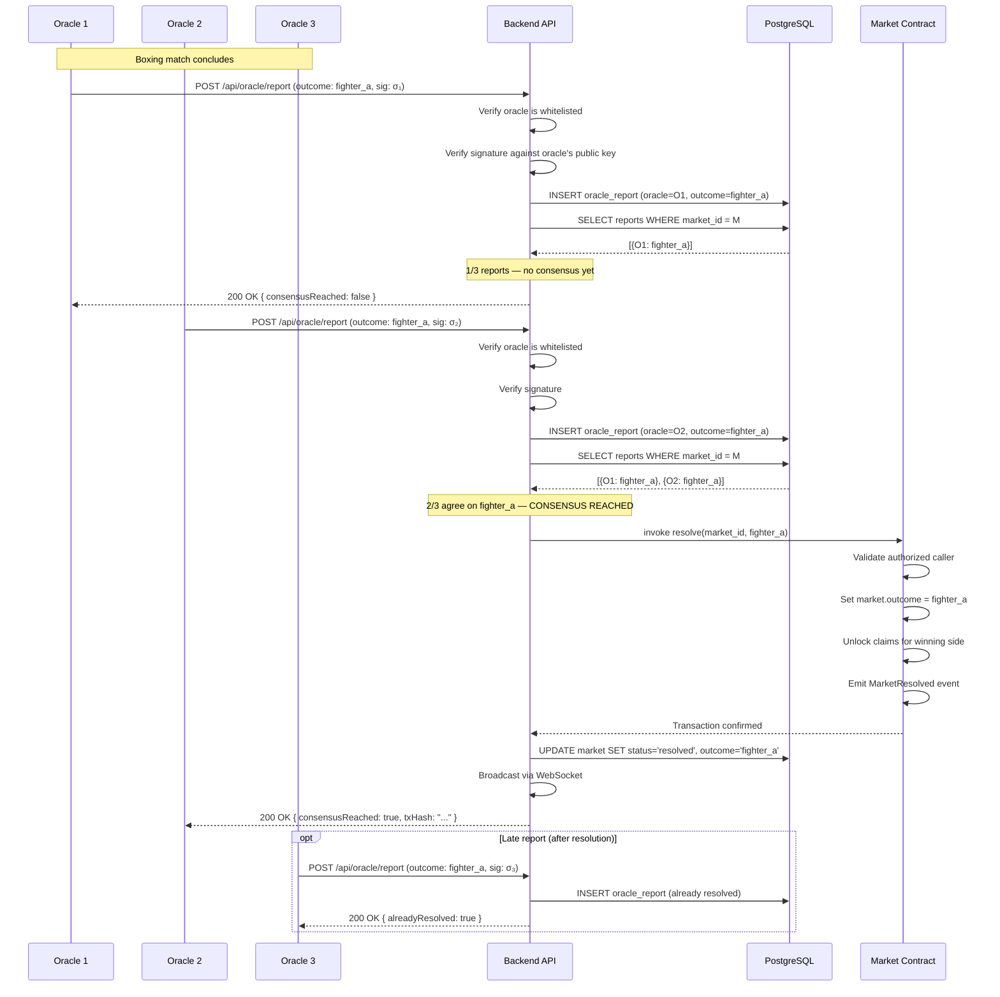
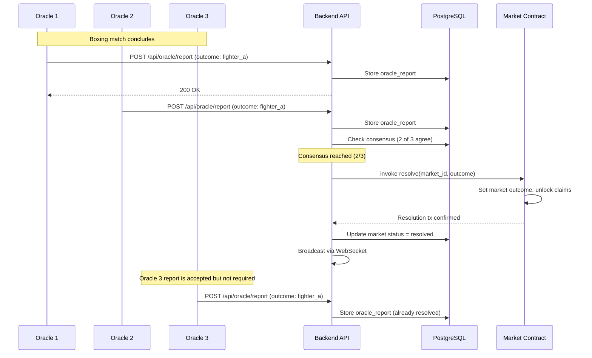
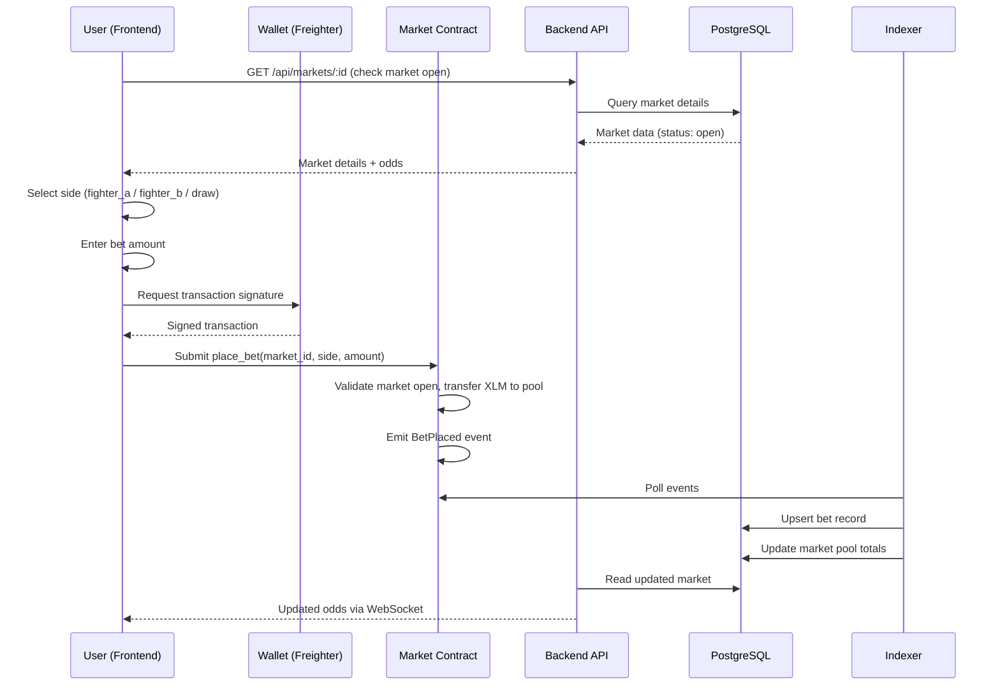
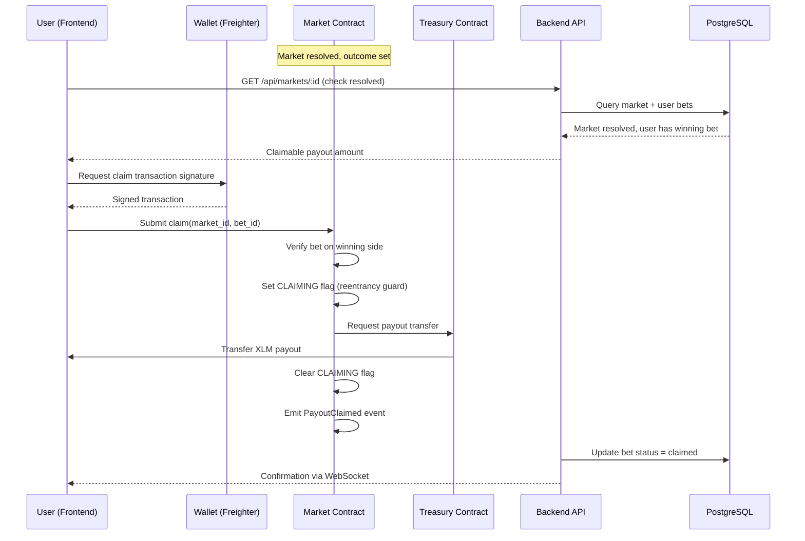

# BANKERCHANGER — Architecture Documentation

This document describes the high-level system architecture, data flows, and key interaction patterns of the BANKERCHANGER decentralized boxing prediction market.

## Table of Contents

- [System Overview](#system-overview)
- [System Diagram](#system-diagram)
- [Component Breakdown](#component-breakdown)
- [Contract Interactions](#contract-interactions)
- [Data Flow: Bet Placement to Resolution](#data-flow-bet-placement-to-resolution)
- [Data Flow: Contract Event to Frontend](#data-flow-contract-event-to-frontend)
- [Indexer Flow](#indexer-flow)
- [API Layers](#api-layers)
- [Caching Strategy](#caching-strategy)
- [Database Schema](#database-schema)
- [Oracle Resolution Flow](#oracle-resolution-flow)
- [Bet Placement Flow](#bet-placement-flow)
- [Claim Payout Flow](#claim-payout-flow)
- [External Dependencies](#external-dependencies)

## System Overview

BANKERCHANGER is a full-stack decentralized application consisting of four main layers:

| Layer | Technology | Purpose |
|-------|-----------|---------|
| **Smart Contracts** | Rust / Soroban SDK | On-chain market logic, treasury, factory |
| **Indexer** | TypeScript | Polls Soroban events, persists to database |
| **Backend API** | Express / TypeScript | REST API, auth, caching, WebSocket feed |
| **Frontend** | Next.js 14 / React | User interface, wallet integration |

Supporting services include PostgreSQL (primary data store), Redis (caching and rate limiting), and Prometheus (metrics).

## System Diagram

## Component Breakdown

### Smart Contracts (Soroban)

| Contract | Source | Responsibility |
|----------|--------|---------------|
| **shared** | `contracts/shared/src/events.rs` | Common types, error codes, AMM math, event helpers |
| **market_factory** | `contracts/market_factory/src/lib.rs` | Creates markets, manages oracle whitelist, emergency pause |
| **market** | `contracts/market/src/lib.rs` | Individual market logic — bet placement, claims, refunds |
| **treasury** | `contracts/treasury/src/lib.rs` | Fund custody, withdrawal limits, payout distribution |

**Security features:** Reentrancy guards (CLAIMING flag), emergency pause, oracle whitelist enforcement, 2-of-3 oracle consensus.

### Indexer

The indexer runs as a standalone TypeScript process that:

1. Polls the Soroban RPC endpoint every 5 seconds via `getEvents()`.
2. Filters events by contract ID and topic.
3. Parses `scVal` event payloads.
4. Upserts event data into PostgreSQL.
5. Maintains a cursor (`indexer_checkpoints` table) for crash recovery.

### Backend API

Express.js application providing:

- **REST API** — Markets, bets, claims, admin, auth, oracle endpoints.
- **Authentication** — JWT with session version tracking, 2FA/TOTP support.
- **Rate Limiting** — Redis-backed, per-route IP and user-based limits.
- **Caching** — Redis with 30-second TTLs and pattern-based invalidation.
- **WebSocket** — Real-time activity feed for live market updates.
- **Cron Jobs** — Auto-resolution, auto-lock, session/token cleanup.
- **Metrics** — Prometheus counters and histograms on `/metrics`.

### Frontend

Next.js 14 App Router application with:

- **State management** — Zustand stores.
- **Data fetching** — TanStack React Query.
- **Wallet integration** — Stellar SDK for transaction signing.
- **Styling** — Tailwind CSS.

## Contract Interactions

The Soroban contracts are the source of truth for market state and funds. The backend and indexer only observe and relay on-chain state; they never mutate balances directly.

### `contracts/market/src/lib.rs`

- `place_bet(market_id, side, amount)` — validates the market is open, transfers XLM into the pool, and emits a `bet_placed` event via the shared event helpers.
- `claim(market_id, bet_id)` — verifies the bet is on the winning side, sets the `CLAIMING` reentrancy flag, requests a payout from the treasury, clears the flag, and emits `payout_claimed`.
- `resolve(market_id, outcome)` — callable only by the factory; stores the consensus outcome, enters `ResolutionPending`, and emits `market_resolution_pending`.
- `finalize_resolution(market_id)` — callable by anyone after the dispute cooldown (ledgers **and** seconds) elapses; transitions the market to `Resolved` and emits `market_resolved`.

### `contracts/market_factory/src/lib.rs`

- `create_market(config)` — deploys a new market contract and registers it.
- `resolve(market_id, outcome)` — the authorized caller the market contract trusts for resolution.
- Oracle whitelist management and emergency pause controls.

### `contracts/treasury/src/lib.rs`

- Custodies pooled funds and enforces withdrawal limits.
- Distributes payouts when the market contract requests a transfer during `claim`.

### `contracts/shared/src/events.rs`

- Defines the canonical event topics and payload structures (`bet_placed`, `market_resolved`, `payout_claimed`, etc.) emitted by all contracts.
- The indexer decodes events using these shared definitions, keeping on-chain and off-chain representations in sync.

## Data Flow: Bet Placement to Resolution

End-to-end flow from a user placing a bet through oracle resolution and payout claim.

## Data Flow: Contract Event to Frontend

This diagram shows how an on-chain event propagates through the system to the end user.

## Indexer Flow

The standalone `indexer/` microservice is the single authoritative service responsible for polling Stellar blockchain events. It is composed of three cooperating components:

1. **`StellarIndexer`** — The polling loop. Calls the Soroban RPC `getEvents()` endpoint every 5 seconds, filters by contract ID and topic, and hands raw events to the processor. It owns the run loop and retry/backoff behavior.
2. **`EventProcessor`** — Decodes `scVal` payloads using the shared event definitions, maps each event to its domain record (bet, market resolution, payout, etc.), and upserts the results into PostgreSQL inside a transaction.
3. **`ledgerTracker`** — Persists the last processed ledger cursor in the `indexer_checkpoints` table so the indexer can resume from the correct position after a crash or restart, avoiding gaps or duplicate processing.

- **Service Boundary**: The standalone `indexer/` service polls Soroban RPC and Horizon, writes canonical events into the shared PostgreSQL `blockchain_events` table, and updates `indexer_checkpoints`.
- **Backend Role**: The `backend/` service does not run active polling loops; it reads event records from the shared PostgreSQL database and serves queries/WebSockets to clients.
- **Port Assignment**: Indexer runs on port 3002 (REST & WebSocket streams) while Backend runs on port 3001.

## API Layers

The backend is organized into routes → controllers → services. Each route group maps to a controller that validates input and delegates business logic to a service.

| Layer | Route Group | Responsibility |
|-------|-------------|---------------|
| **Market routes** | `/api/markets` | List markets, fetch market detail, odds, and event history |
| **Bet routes** | `/api/bets` | Place-bet metadata, list user bets, claim status |
| **Oracle routes** | `/api/oracle` | Submit oracle reports, query consensus status |

- **Routes** — Express routers that define endpoints and attach middleware (auth, rate limiting, validation).
- **Controllers** — Parse/validate requests, call services, and shape HTTP responses.
- **Services** — Contain business logic (consensus checks, market queries, resolution orchestration) and are the only layer that touches the database and cache.

## Caching Strategy

Caching is implemented in `backend/src/services/cache.service.ts` on top of the Redis client in `backend/src/lib/redis.ts`.

- **`redis.ts`** — Creates and exports the shared Redis connection used for caching and rate limiting.
- **`cache.service.ts`** — Provides `get`/`set`/`invalidate` helpers with a default **30-second TTL** for market and odds reads, plus pattern-based invalidation (e.g. `markets:*`) triggered when the indexer or a resolution changes underlying data.
- **Rate limiting** — Redis-backed per-route IP and user-based limits share the same Redis instance.
- **Invalidation** — Writes that affect a market invalidate the related cache keys so the next read repopulates fresh data.

## Database Schema

The schema is defined in `backend/db/schema.sql` and mirrored in TypeScript types in `backend/src/db/schema.ts`.

## Oracle Resolution Flow

### Oracle Consensus Mechanism

Oracles are whitelisted Stellar accounts that submit match outcome reports to the backend. The system uses a **2-of-3 consensus model** to prevent any single oracle from unilaterally resolving a market.

#### How Consensus Works

1. **Report Submission**: After a boxing match concludes, each whitelisted oracle independently fetches the official result and submits a signed report via `POST /api/oracle/report`. The report includes the market ID, declared outcome (`fighter_a`, `fighter_b`, or `draw`), and a cryptographic signature.

2. **Report Storage**: Each report is stored in the `oracle_reports` table with the oracle's public key, reported outcome, signature, and timestamp. Reports are immutable once stored.

3. **Consensus Check**: After storing each new report, the backend queries all reports for that market. If **2 out of 3** whitelisted oracles have submitted reports with the **same outcome**, consensus is reached.

4. **On-Chain Resolution**: Once consensus is achieved, the backend invokes the `resolve()` method on the market's Soroban contract. The contract:
   - Validates the resolver is the factory contract (authorized caller)
    - Stores the consensus outcome and enters `ResolutionPending`
    - Keeps claims locked while the dispute cooldown is active
    - Emits a `market_resolution_pending` event

5. **Cooldown Finalization**: Anyone may call `finalize_resolution` after both the configured ledger count and seconds have elapsed. The market becomes `Resolved` and claims unlock only after both thresholds pass. This dual check accounts for variable ledger close times.

6. **Late Reports**: If a third oracle submits a report after resolution, the report is still stored for audit purposes but does not trigger any further action.

7. **No Consensus**: If oracles submit conflicting reports (e.g., 1 for `fighter_a`, 1 for `fighter_b`, 1 for `draw`), the market remains in `locked` status. An automated retry mechanism (`autoResolution.cron.ts`) will re-attempt resolution periodically, giving oracles time to converge.

`MarketConfig.dispute_cooldown_ledgers` and `MarketConfig.dispute_cooldown_secs` are independent minimums. Finalization requires the ledger sequence and timestamp to reach their respective deadlines. Zero values use defaults of 720 ledgers and 3,600 seconds.

#### Consensus Flow Diagram

#### Oracle Security Model

| Property | Implementation |
|----------|---------------|
| **Identity** | Each oracle is identified by a whitelisted Stellar public key |
| **Authentication** | Reports must carry a valid Ed25519 signature verifiable against the oracle's key |
| **Authorization** | Only the oracle's registered public key can submit reports on its behalf |
| **Sybil resistance** | Oracles must be whitelisted by the market factory admin |
| **Collusion resistance** | 2-of-3 threshold means no single oracle can unilaterally resolve a market |
| **Non-repudiation** | Signed reports are stored immutably for audit |
| **Liveness** | Auto-resolution cron re-attempts resolution if oracles fail to converge initially |

### Original Oracle Resolution Sequence

Oracles are whitelisted accounts that submit match outcome reports. Resolution requires 2-of-3 consensus.

## Bet Placement Flow

## Claim Payout Flow

## External Dependencies

| Dependency | Role |
|------------|------|
| **Stellar / Soroban** | Blockchain network, Soroban RPC, and smart contract runtime |
| **PostgreSQL** | Primary data store (markets, bets, oracle reports, events, checkpoints) |
| **Redis** | Caching and rate limiting |
| **Docker** | Containerized local development and deployment of services |
| **CI** | Automated build, test, and contract verification pipeline |
| **Prometheus** | Metrics scraping and monitoring |

